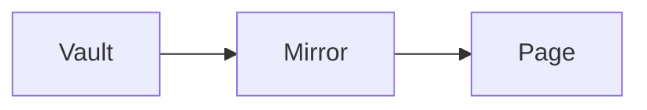

Posts use the same syntax as Obsidian.

> [!tip]
> Folders are only for you. The URL is always `/posts/<slug>`.

## Code

```go
fmt.Println("hello")
```

## Math

The area of a circle is $\pi r^2$.

## Diagrams


